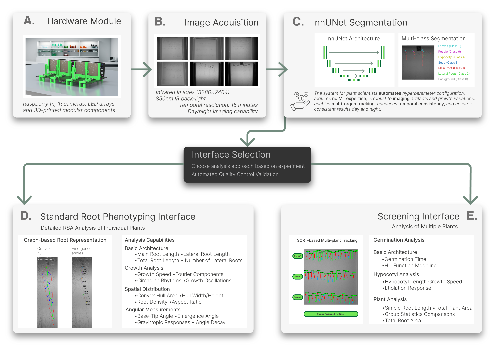

## ChronoRoot 2.0: An Open AI-Powered Platform for 2D Temporal Plant Phenotyping



### Abstract
Plant developmental plasticity, particularly in root system architecture, is fundamental to understanding adaptability and agricultural sustainability. Existing automated phenotyping solutions face limitations including binary segmentation approaches, restricted structural analysis capabilities, and text-based interfaces that limit accessibility, with most focusing solely on root structures while overlooking valuable information from simultaneous analysis of multiple plant organs. ChronoRoot 2.0 builds upon established low-cost hardware while significantly enhancing software capabilities and usability. The system employs nnUNet architecture for multi-class segmentation, demonstrating significant accuracy improvements while simultaneously tracking six distinct plant structures encompassing root, shoot, and seed components: main root, lateral roots, seed, hypocotyl, leaves, and petiole. This architecture enables easy retraining and incorporation of additional training data without requiring machine learning expertise. The platform introduces dual specialized graphical interfaces: a Standard Interface for detailed architectural analysis with novel gravitropic response parameters, and a Screening Interface enabling high-throughput analysis of multiple plants through automated tracking. Functional Principal Component Analysis integration enables discovery of novel phenotypic parameters through temporal pattern comparison. We demonstrate multi-species analysis, with Arabidopsis thaliana and Solanum lycopersicum, both morphologically distinct plant species. Three use cases in Arabidopsis thaliana and validation with tomato seedlings demonstrate enhanced capabilities: circadian growth pattern characterization, gravitropic response analysis in transgenic plants, and high-throughput etiolation screening across multiple genotypes. ChronoRoot 2.0 maintains the low-cost, modular hardware advantages of its predecessor while dramatically improving accessibility through intuitive graphical interfaces and expanded analytical capabilities. The open-source platform makes sophisticated temporal plant phenotyping more accessible to researchers without computational expertise.


### Citation
````
@article{10.1093/gigascience/giag018,
    author = {Gaggion, Nicolás and Boccardo, Noelia A and Bonazzola, Rodrigo and Legascue, María Florencia and Mammarella, María Florencia and Rodriguez, Florencia Sol and Aballay, Federico Emanuel and Catulo, Florencia Belén and Barrios, Andana and Santoro, Luciano J and Accavallo, Franco and Villarreal, Santiago Nahuel and Pereyra-Bistrain, Leonardo I and Benhamed, Moussa and Crespi, Martin and Ricardi, Martiniano María and Petrillo, Ezequiel and Blein, Thomas and Ariel, Federico and Ferrante, Enzo},
    title = {ChronoRoot 2.0: An Open AI-Powered Platform for 2D Temporal Plant Phenotyping},
    journal = {GigaScience},
    pages = {giag018},
    year = {2026},
    month = {02},
    abstract = {Plant developmental plasticity, particularly in root system architecture, is fundamental to understanding adaptability and agricultural sustainability. Existing automated phenotyping solutions face limitations including binary segmentation approaches, restricted structural analysis capabilities, and text-based interfaces that limit accessibility, with most focusing solely on root structures while overlooking valuable information from simultaneous analysis of multiple plant organs.ChronoRoot 2.0 builds upon established low-cost hardware while significantly enhancing software capabilities and usability. The system employs nnUNet architecture for multi-class segmentation, demonstrating significant accuracy improvements while simultaneously tracking six distinct plant structures encompassing root, shoot, and seed components: main root, lateral roots, seed, hypocotyl, leaves, and petiole. This architecture enables easy retraining and incorporation of additional training data without requiring machine learning expertise. The platform introduces dual specialized graphical interfaces: a Standard Interface for detailed architectural analysis with novel gravitropic response parameters, and a Screening Interface enabling high-throughput analysis of multiple plants through automated tracking. Functional Principal Component Analysis integration enables discovery of novel phenotypic parameters through temporal pattern comparison. We demonstrate multi-species analysis, with Arabidopsis thaliana and Solanum lycopersicum, both morphologically distinct plant species. Three use cases in Arabidopsis thaliana and validation with tomato seedlings demonstrate enhanced capabilities: circadian growth pattern characterization, gravitropic response analysis in transgenic plants, and high-throughput etiolation screening across multiple genotypes.ChronoRoot 2.0 maintains the low-cost, modular hardware advantages of its predecessor while dramatically improving accessibility through intuitive graphical interfaces and expanded analytical capabilities. The open-source platform makes sophisticated temporal plant phenotyping more accessible to researchers without computational expertise.https://chronoroot.github.io},
    issn = {2047-217X},
    doi = {10.1093/gigascience/giag018},
    url = {https://doi.org/10.1093/gigascience/giag018},
    eprint = {https://academic.oup.com/gigascience/advance-article-pdf/doi/10.1093/gigascience/giag018/67174649/giag018.pdf},
}

````
