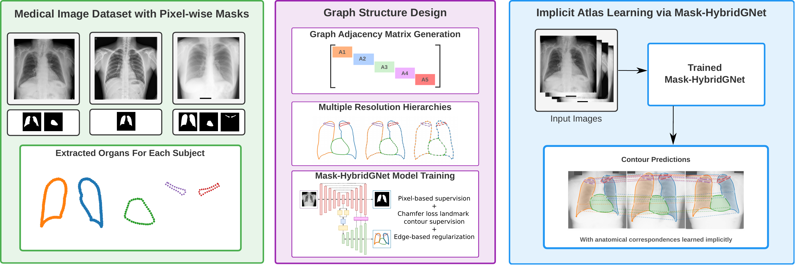

## Mask-HybridGNet: Graph-based segmentation with emergent anatomical correspondence from pixel-level supervision



### Abstract

Graph-based medical image segmentation represents anatomical structures using boundary graphs, providing fixed-topology landmarks and inherent population-level correspondences. However, their clinical adoption has been hindered by a major requirement: training datasets with manually annotated landmarks that maintain point-to-point correspondences across patients rarely exist in practice. We introduce Mask-HybridGNet, a framework that trains graph-based models directly using standard pixel-wise masks, eliminating the need for manual landmark annotations. Our approach aligns variable-length ground truth boundaries with fixed-length landmark predictions by combining Chamfer distance supervision and edge-based regularization to ensure local smoothness and regular landmark distribution, further refined via differentiable rasterization. A significant emergent property of this framework is that predicted landmark positions become consistently associated with specific anatomical locations across patients without explicit correspondence supervision. This implicit atlas learning enables temporal tracking, cross-slice reconstruction, and morphological population analyses. Beyond direct segmentation, Mask-HybridGNet can extract correspondences from existing segmentation masks, allowing it to generate stable anatomical atlases from any high-quality pixel-based model. Experiments across chest radiography, cardiac ultrasound, cardiac MRI, and fetal imaging demonstrate that our model achieves competitive results against state-of-the-art pixel-based methods, while ensuring anatomical plausibility by enforcing boundary connectivity through a fixed graph adjacency matrix. This framework leverages the vast availability of standard segmentation masks to build structured models that maintain topological integrity and provide implicit correspondences.

### Citation
````
@misc{gaggion2026maskhybridgnetgraphbasedsegmentationemergent,
      title={Mask-HybridGNet: Graph-based segmentation with emergent anatomical correspondence from pixel-level supervision}, 
      author={Nicolás Gaggion and Maria J. Ledesma-Carbayo and Stergios Christodoulidis and Maria Vakalopoulou and Enzo Ferrante},
      year={2026},
      eprint={2602.21179},
      archivePrefix={arXiv},
      primaryClass={cs.CV},
      url={https://arxiv.org/abs/2602.21179}, 
}
````
